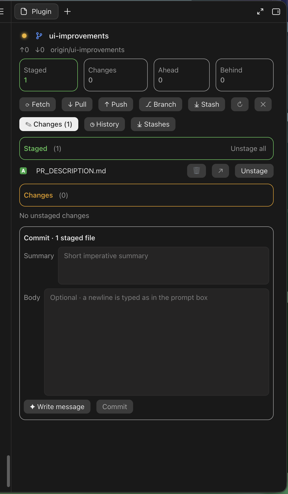

# claude-fork-git-pane

A Fork-style git panel for Claude Code Desktop: changes, commit graph, submodules, stashes and AI commit messages, without leaving the app. The terminal keeps the original text view.



Based on [netgfx/claude-git-mod](https://github.com/netgfx/claude-git-mod) (MIT). The git logic, the AI commit messages and the terminal view come from that project. This fork adds the Desktop view.

## Features

- **Header**: a glowing status orb (green clean, amber changes, red behind, spinning ring while busy), the branch, the branch it came from, upstream, and four tiles: Staged, Changes, Ahead, Behind.
- **Toolbar**: Fetch, Pull, Push, Branch, Stash, Refresh, Settings and Close, in one wrapping row.
- **Changes tab**: Staged and Changes lists with a status badge per file. Sections fold, and an optional **folder tree** groups files by folder. Click a file to open its diff inline, with a Close diff button at both ends. Stage, Unstage, Discard (with confirmation) and Open in your editor.
- **Commit box**: a Summary with a length hint (50 and 72 characters), a Body and **Write message**, which asks a model to draft the message from the staged diff. The message you typed is kept per repository, also across restarts.
- **Pull**: fast-forward only. When the branches diverged, the panel offers **Pull with merge** or **Pull with rebase**. A conflict is undone at once, so the repository is never left half-merged.
- **Branches**: type in the Branch search to check out, **create** a branch (and check it out), **rename** the current one, or delete a merged local branch (two presses, and git refuses unmerged ones).
- **History tab**: commit graph drawn in SVG (lanes, merges, labels, pulsing HEAD). Search by subject, author, hash or ref, and switch between all branches and this branch. Click a commit for its message, refs, files and the diff of each file.
- **Submodules tab**: list with state. Enter a submodule and every git call moves into it. A breadcrumb goes back.
- **Stashes tab**: list with Restore and Remove (with confirmation).
- **Settings** (`/git-settings` or the ⚙ button): glow, pulse, orb, tiles, folder tree, summary counter, box heights, first tab, refresh rate, auto fetch, commits per page, diff size limit and toasts. Changes apply at once and are remembered.
- **Toasts** when Fetch, Pull, Push, Commit or Stash finish.
- A small widget form (branch and change count) when the pane is minimized. Animations stop when the system asks for reduced motion.

The panel refreshes while open (every 3 seconds by default), and after Claude runs a shell or edit tool.

## Settings

Open them with `/git-settings` or the ⚙ button in the toolbar. Every change applies at once and is remembered between sessions. **Reset** in the header restores all defaults. On/Off options show a green **On** or a red **Off** with a button to switch. The others cycle through their values each time you press them (▾).

**Visual**

| Option | Default | What it does |
| --- | --- | --- |
| Glow | On | Soft glow on the status orb, the tiles and the clean-state rings |
| Pulse | On | The glow and the HEAD dot in History slowly pulse. Always off when the system asks for reduced motion |
| Status orb | On | The colored dot before the branch name |
| Summary tiles | On | Staged, Changes, Ahead and Behind under the header |
| Folder tree | Off | Group the files by folder in Staged and Changes |
| Summary counter | On | A hint under the Summary: good length, past 50, past 72 characters |
| Summary height | 3 | Lines of the Summary box (1, 2, 3, 5) |
| Body height | 10 | Lines of the Body box (4, 6, 10, 15, 20) |

**Behavior**

| Option | Default | What it does |
| --- | --- | --- |
| Open on start | On | Open the panel by itself when the session folder is a git repository |
| First tab | Changes | The tab shown when the panel opens (Changes or History) |
| Refresh every | 3s | How often the panel reads the repository while open (1, 3, 5, 10, 30 seconds). Local only |
| Auto fetch | Off | Fetch all remotes in the background every 1, 5, 10 or 15 minutes. It needs working credentials and never shows a notice |

**History and diffs**

| Option | Default | What it does |
| --- | --- | --- |
| Commits per page | 100 | How many commits History loads at a time (50, 100, 200, 500) |
| Diff size limit | 30k | Characters of one diff drawn at once (10k, 30k, 60k, 90k). A bigger diff shows its first hunks |

**Alerts**

| Option | Default | What it does |
| --- | --- | --- |
| Toast when done | On | A toast when Fetch, Pull, Push, Commit or Stash finish |

## Install

```
/plugin marketplace add OriolClariana/claude-fork-git-pane
/plugin install fork-git-pane@fork-git-pane-mod
```

If your organization blocks marketplaces, clone the repo and add this to `~/.claude/settings.json`:

```json
{
  "env": {
    "CLAUDE_CODE_PLUGIN_DIRS": "/path/to/claude-fork-git-pane",
    "CLAUDE_CODE_PLUGIN_DIR_WATCH": "1"
  }
}
```

## Usage

- `/git` opens the panel. It also opens by itself when the session folder is a git repository.
- `/git-settings` opens the settings. `/git-close` closes the panel, and so does the ✕ button in the toolbar.

## Safety

- Every git call runs by argument list, with no shell, and with the repository's hooks turned off. `pre-commit` and `commit-msg` hooks do **not** run for commits made from the panel.
- Pull is `--ff-only` by default. Merge and rebase only run when you press them after a diverged pull, and a conflict is aborted. There is no reset or force push.
- Branch delete uses `git branch -d`, so only merged branches go.
- Discard and Remove stash ask for a second press. Discard cannot be undone.
- `GIT_TERMINAL_PROMPT=0`: if git needs credentials, it fails at once instead of hanging. A credential manager or SSH agent still works.

## Known limits

- The pane width is a request (140 columns). A width you drag wins, and on a narrow pane the toolbar wraps.
- Buttons cannot hold SVG, so file and toolbar buttons use text and emoji icons.
- There is no floating window: the mod API only has dock, inline and widget panes.
- If Desktop does not let you close the last pane, `/git-close` and ✕ cannot either.
- Graph lanes past 8 are drawn on the last lane.

## Develop

```
claude plugin validate .
claude plugin test .
```

Pushing to `main` with a new `version` in `.claude-plugin/plugin.json` creates a GitHub release automatically.

## Author

Oriol Marc Clariana Justes, on top of the work of Michael Dobekidis.

## License

MIT, see [LICENSE](LICENSE). You can use, change and share it for free. Keep the copyright notices in `LICENSE`, and if you build on this project or share it, please credit it with a link to [OriolClariana/claude-fork-git-pane](https://github.com/OriolClariana/claude-fork-git-pane). Do not present it as your own work.
